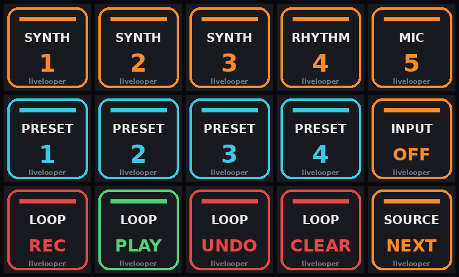

# livelooper companion

*designed by groovex* · [Deutsch](README.de.md)

Pick **which track livelooper records** at the press of a key during a performance – synth 1–3, rhythm or mic – and switch **synth presets** (e.g. Pigments). Runs in Ableton Live 12 with **ClyphX Pro**, easiest to play from an **Elgato Stream Deck** (15 keys).

## What happens on a key press?
`SYNTH 2` →
1. The LOOPER track gets **Synth 2 (Post FX)** as input and monitor **In**.
2. Synth 2 is **armed** (your keyboard plays it), Synth 1 and 3 are disarmed.
3. Live's status bar shows `livelooper: recording source -> Synth 2`.

`PRESET 1–4` send a Program Change to the active synth. `LOOP REC/PLAY/UNDO/CLEAR` drive livelooper directly.

## Install in 3 steps
1. **Requirements:** Ableton Live 12, ClyphX Pro (selected once as Control Surface in *Settings → Link, Tempo & MIDI*), optionally a Stream Deck with the *Midi* plugin by Trevliga Spel.
2. **Download** → **double-click** `install.command`. It copies the User Action, adds macros and X-Controls to ClyphX Pro (with backup, safe to run again) and puts the Stream Deck icons on your Desktop. If macOS says “unidentified developer”: right-click → Open.
3. **Build the Live Set** as in [docs/en/setup.md](docs/en/setup.md) – 6 tracks, 2 IAC ports, done.

Stream Deck: [docs/en/stream-deck.md](docs/en/stream-deck.md) · Presets: [docs/en/presets.md](docs/en/presets.md) · Problems: [docs/en/troubleshooting.md](docs/en/troubleshooting.md)

Uninstall: double-click `uninstall.command`.

## Track layout
| # | Name (exact) | Type | Input | Output |
|---|---|---|---|---|
| 1–3 | `Synth 1`, `Synth 2`, `Synth 3` | MIDI + instrument | All Ins | Master |
| 4 | `Rhythm` | MIDI/audio | – | Master |
| 5 | `Mic` | Audio | Ext. In 1 | Master |
| 6 | `LOOPER` | Audio + livelooper | set by the script | Master |

Different names? Edit `SOURCES` and `LOOPER_TRACK` at the top of `clyphx/user_actions/livelooper_companion.py` and run the installer again.

## License
AGPL-3.0 – see [LICENSE](LICENSE). ClyphX Pro, Pigments and Stream Deck are products of their respective makers and not part of this repo.
