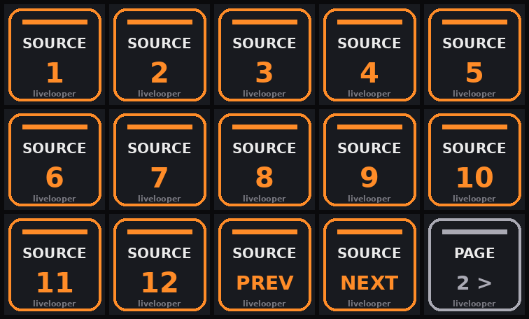
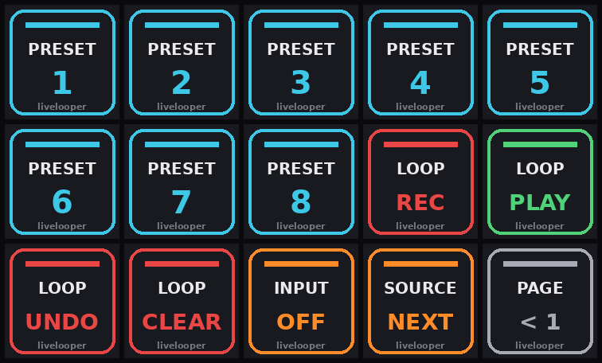

# Stream Deck (standard, 15 keys, 2 pages)

## 1. Plugin
Stream Deck app → **Marketplace** → install **“Midi” by Trevliga Spel** (not “Midi Button”). The current price is shown in the Marketplace.

## 2. Profile
New profile **livelooper** with two pages. Note keys: action **Midi → Note On/Off**, type *Push*, **port `LL Deck`**, **channel 16**, velocity 127. Looper keys: **Midi → Control Change**, port `LL Deck`, channel 16, value 127. Page switch: built-in **Stream Deck → Next/Previous Page**.
Icons: drag the PNGs from *livelooper Stream Deck Icons* (Desktop) onto the keys. Tip: rename source key titles to your track names (e.g. “Bass”).

**Page 1 · Sources** 

| Row | 1 | 2 | 3 | 4 | 5 |
|---|---|---|---|---|---|
| 1 | SOURCE 1 · **36** | SOURCE 2 · **37** | SOURCE 3 · **38** | SOURCE 4 · **39** | SOURCE 5 · **40** |
| 2 | SOURCE 6 · **41** | SOURCE 7 · **42** | SOURCE 8 · **43** | SOURCE 9 · **44** | SOURCE 10 · **45** |
| 3 | SOURCE 11 · **46** | SOURCE 12 · **47** | PREV · **48** | NEXT · **49** | Page 2 |

**Page 2 · Perform** 

| Row | 1 | 2 | 3 | 4 | 5 |
|---|---|---|---|---|---|
| 1 | PRESET 1 · **52** | PRESET 2 · **53** | PRESET 3 · **54** | PRESET 4 · **55** | PRESET 5 · **56** |
| 2 | PRESET 6 · **57** | PRESET 7 · **58** | PRESET 8 · **59** | REC · **CC 20** | PLAY · **CC 21** |
| 3 | UNDO · **CC 22** | CLEAR · **CC 23** | INPUT OFF · **50** | NEXT · **49** | Page 1 |

Fewer than 12 sources? Leave spare keys empty – they only report “unknown source”. Extra: notes 60/61 = rack chain back/forward.

## 3. Map the looper keys (once, in the template)
1. Turn on **MIDI Map Mode** (⌘ M).
2. Click livelooper's **Rec** parameter (expose it via *Configure* in the device header if needed).
3. Press the Stream Deck **REC** key. Same for PLAY, UNDO, CLEAR.
4. ⌘ M off and save the template again.
